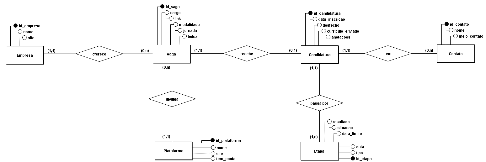
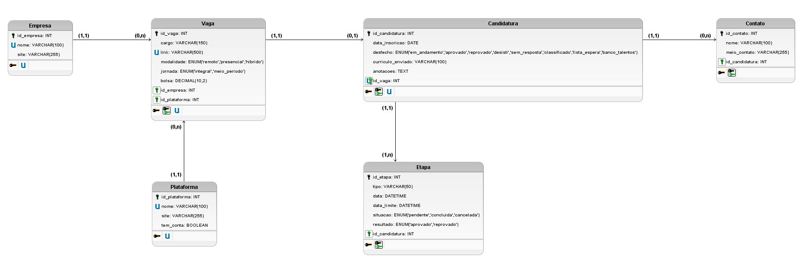

# Tracker de Candidaturas de Estágio


Projeto pessoal nascido de um problema real: ao buscar estágio por várias plataformas (LinkedIn, CIEE, sites das empresas), é fácil perder o controle de **onde existe conta, onde houve inscrição, em que etapa cada processo está e quando são as provas e os prazos**.

O Tracker centraliza tudo em um só lugar: cadastra vagas e candidaturas, guarda o histórico de etapas de cada processo e mostra os próximos eventos por data, destacando o que está perto de vencer.

## Status

- [x] Requisitos (MoSCoW)
- [x] Modelo conceitual (MER/DER)
- [x] Modelo lógico (tabelas, tipos e domínios)
- [ ] Script SQL (MySQL)
- [ ] Backend (API em Python)
- [ ] Frontend
- [ ] Painel kanban
- [ ] Documentação final e execução local

## Funcionalidades planejadas

Versão 1 (detalhes em [docs/requisitos.md](docs/requisitos.md)):

- Lista dos **próximos eventos** (etapas e provas) ordenados por data, destacando prazos próximos e atrasados
- Cadastro de **plataformas**, **empresas**, **vagas** e **candidaturas**
- **Histórico de etapas** de cada processo (inscrição, prova, entrevista, teste), com a etapa atual sinalizada
- **Desfecho** do processo: em andamento, aprovado, reprovado, desisti, sem resposta, classificado, lista de espera ou banco de talentos
- **Contatos do recrutador** (só o necessário: nome e um meio de contato) e **anotações** em cada candidatura
- Editar, excluir, buscar e filtrar por empresa, plataforma ou etapa
- Painel estilo kanban por etapa
- Layout responsivo (computador, tablet e celular)

Próximas versões: avisos de prazos por Telegram ou e-mail, login, notificação de novas vagas e comparação entre currículo e requisitos da vaga.

## Modelagem

O modelo tem seis entidades (Empresa, Plataforma, Vaga, Candidatura, Etapa e Contato).

**Modelo conceitual**



**Modelo lógico**



As decisões de modelagem, com justificativas, o esquema relacional, os tipos das colunas e os valores únicos estão em [docs/modelagem/decisoes.md](docs/modelagem/decisoes.md).

## Tecnologias

- **Banco de dados:** MySQL
- **Backend:** Python (Flask ou FastAPI, a definir)
- **Frontend:** HTML, CSS e JavaScript
- **Modelagem:** BRModelo

## Estrutura do projeto

```
tracker-candidaturas/
├── docs/
│   ├── requisitos.md
│   └── modelagem/        # decisões, modelo conceitual e modelo lógico
├── database/             # script SQL
├── backend/              # API
├── frontend/             # interface
└── README.md
```

## Como rodar

Em breve.

Os dados pessoais de uso real (candidaturas e contatos) ficam apenas na máquina local e não entram no repositório.

## Autor

**Piêtro Bitencourt Nunes**

- GitHub: [pietrobitencourt](https://github.com/pietrobitencourt)
- LinkedIn: [piiettrosz](https://www.linkedin.com/in/piiettrosz/)